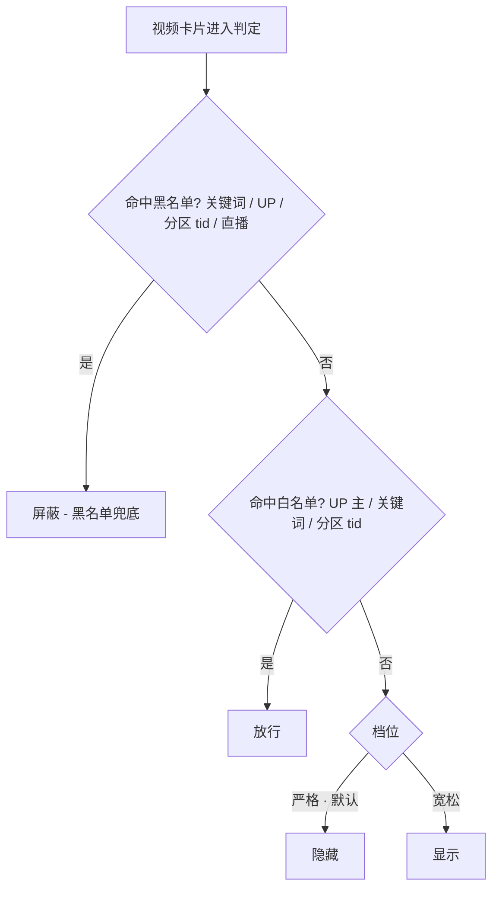

# bilibili-teen-up · B站网页端青少年模式插件 计划书

> 项目名：`bilibili-teen-up`
> 类型：Chrome MV3 浏览器扩展
> 作用域：`*.bilibili.com`（含子域名 search / popular / live / t / space / bangumi）
> 状态：**方案已定稿，待开发**
> 定稿日期：2026-11-11

---

## 一、项目背景与目标

B站官方青少年模式仅在 APP 端提供完整体验（编辑精选内容池、禁直播、时长管控），网页端缺失。本插件在网页端实现等效青少年模式：

| 目标 | 说明 |
|---|---|
| 屏蔽不良内容 | 游戏、暴力、恐怖/灵异、直播、低俗擦边等 |
| 保留知识内容 | 历史、地理、纪录片、动画、英语、文学、科普等 |
| 白名单为主 | 白名单 UP 主 / 关键词 / 分区决定放行，黑名单兜底拦截 |
| 青少年内容流 | 首页推荐流替换为自建白名单聚合流（白名单 UP 投稿 + 知识/纪录片分区精选） |
| 无家长管控 | 不设密码、不做时长/宵禁，popup 开关直接生效，使用最简单 |

---

## 二、需求决策记录（定稿）

| # | 决策点 | 结论 |
|---|---|---|
| 1 | 默认过滤档位 | **白名单为主 + 黑名单为辅**（严格档为默认，可切宽松档） |
| 2 | 内容流形态 | **替换B站首页推荐流**（隐藏原生推荐，注入自建青少年流） |
| 3 | 家长管控 | **无**（无密码、无时长、无宵禁） |
| 4 | 直播处理 | **全站禁直播**（live.bilibili.com 整站拦截 + 各处直播入口隐藏） |
| 5 | UP 名单导入方式 | **外部整理的 UP 名称文本批量导入**（分隔符分割），非 API 拉取关注列表 |
| 6 | 项目命名 | `bilibili-teen-up` |

---

## 三、总体架构

```
bilibili-teen-up/
├── manifest.json          # MV3；host_permissions: https://*.bilibili.com/*
├── background.js          # service worker：API 查询、wbi 签名、BV 缓存、限流队列
├── early.js               # document_start 注入：抢先隐藏可疑卡片（防闪现）
├── content.js             # ISOLATED：DOM 过滤引擎（MutationObserver + 兜底轮询）
├── content.css            # 拦截层 / 占位 / 替换首页流样式
├── popup/                 # popup.html/js/css：总开关、严格/宽松切换、最近屏蔽速览
├── options/               # options.html/js/css：词库、UP 名单、导入导出、屏蔽记录
├── lib/                   # wbi.js（签名）、judge.js（判定链纯函数，供复用与测试）
└── icons/                 # icon16/48/128
```

沿用既有 MV3 插件（yopu-helper-extension）的成熟惯例：`early.js` 于 `document_start` 先行隐藏、`content.js` 于 `document_end` 精确放行、选择器集中配置多备选。

---

## 四、核心判定链（过滤引擎）

**黑名单优先级最高（兜底），白名单决定放行，中间地带按档位处理：**



判定链实现在 `lib/judge.js`（纯函数，输入卡片元数据 + 名单配置，输出 `pass / block / strict-hide`），DOM 层与 API 层共用，保证全站规则一致。

要点：

1. **黑名单兜底**：白名单 UP 发布的标题/标签命中黑词（如游戏、恐怖）同样拦截，不因白名单身份放行。
2. **严格档（默认）**：未命中任何名单的中间地带内容隐藏；家长调词库期间可切「宽松档」（此时退化为黑名单模式，白名单仅服务青少年流）。
3. **UP 匹配规则**：`mid` 精确匹配优先；无 `mid` 条目按名称全等匹配（trim 后 `===`，不做包含匹配）。
4. **播放页守卫 / 搜索页 / 分区页** 均走同一条判定链。

---

## 五、页面覆盖矩阵

| 页面 | URL | 处理方式 |
|---|---|---|
| 首页推荐流 | `www.bilibili.com` | 原生推荐流隐藏，替换为青少年聚合流（见 §6.4） |
| 首页其他 tab（直播/热门等） | 同上 | 直播 tab 整体隐藏；其余 tab 卡片过滤 |
| 搜索页 | `search.bilibili.com` | 搜索词命中黑词 → 拦截提示；结果卡片过滤 |
| 播放页 | `www.bilibili.com/video/*` | 播放守卫（标题关键词同步审 + API 查 tid/tags 异步审）；右侧推荐列表/底部相关视频过滤 |
| 分区页 | `www.bilibili.com/v/*` | 卡片过滤 |
| 热门/排行榜 | `popular.bilibili.com` | 卡片过滤 |
| 直播 | `live.bilibili.com` | **整站拦截**（重定向到拦截提示页） |
| 动态页 | `t.bilibili.com` | 动态卡片过滤 |
| 空间页 | `space.bilibili.com` | 黑名单 UP 顶部提示横幅 |
| 热搜榜 / 搜索联想词 | 全站 | 黑词过滤隐藏 |
| 导航入口 | 全站 | 直播、游戏中心等入口隐藏 |

---

## 六、功能模块设计

### 6.1 L0 · 同步关键词过滤（毫秒级，防闪现）

- `early.js` 在 `document_start` 注入隐藏 CSS，`content.js` 精确判定后放行，杜绝首屏闪现。
- 匹配对象：卡片**标题、UP 主名、描述**；预编译正则数组；用户可在词库增删。
- `early` 阶段策略：标题/UP 名命中黑词先隐藏，等待 `content` 精确放行，避免白名单内容被误藏过久。

### 6.2 L1 · 异步 API 分区/标签过滤（精确打击）

- 从卡片链接提取 BV 号 → background 调 `view` 接口取**分区 tid + 标签** → 判定链复核。
- 结果按 BV 缓存（24h）；并发限流 ≤3 + 批量队列；API 失败自动降级为纯 L0。
- **播放页守卫**：进入 `/video/` 先同步审标题（黑词即拦），再异步审 tid/tags；命中 → 全屏拦截层 + 暂停播放器 +「返回首页」按钮。

### 6.3 直播全站拦截

- `live.bilibili.com` 任意路径 → 重定向至插件拦截提示页（说明「青少年模式已禁用直播」）。
- 首页直播卡片、直播 tab、导航直播/游戏入口全部隐藏。

### 6.4 青少年内容流（首页推荐流替换）

- **形态**：在 `www.bilibili.com` 首页隐藏原生推荐区，注入自建卡片流容器（B站风格卡片：封面/标题/UP/播放量），支持滚动加载。
- **数据源**：
  1. 主源：白名单 UP 最新投稿聚合（需 mid，见 §6.5；按时间混排，可切按 UP 分组）
  2. 辅源：知识区(36)/纪录片(177)分区热门与最新精选
  3. 全部卡片**强制过黑名单兜底**（辅源内容不经白名单也需过黑名单筛查）
- **登录态**：background 发起请求带浏览器 Cookie（`credentials: include`），大会员账号可直接观看流中会员纪录片。
- **wbi 签名**：`lib/wbi.js` 纯 JS 实现（`nav` 接口取 img_key/sub_key → mixinKeyEncTab 重排 → 签名 query），仅用于需要签名的接口。
- 番剧（bangumi）页不拦截，动画内容主要通过白名单 UP + 关键词保留。

### 6.5 UP 名称批量导入与 mid 自动回填

**导入（白/黑名单对称支持）**：

| 步骤 | 说明 |
|---|---|
| 粘贴 | 文本框粘贴整段 UP 名称；**分隔符：换行 / 逗号（`,` `，`）/ 顿号 `、` / 分号 / Tab**；不支持空格（UP 名称可含空格） |
| 解析预览 | 去空行、trim、去重；与现有名单比对标记冲突（已在白/黑） |
| 确认入库 | 勾选批量入库 |
| 导出 | 名单一键导出为同格式名称文本（备份/迁移/继续编辑） |

**匹配与回填机制**：

- 条目结构 `{ name, mid?, face?, addedAt }`；有 mid → mid 精确匹配，无 mid → 名称全等匹配。
- **mid 自动回填**：页面上出现该 UP 的卡片时，从卡片 UP 主链接（`space.bilibili.com/{mid}`）提取 mid 自动补全，此后升级为 mid 匹配（B站允许重名，回填后重名风险自愈）。
- **智能补全（可选按钮）**：调B站用户搜索接口按名称查 mid，结果列表（头像/昵称/粉丝数）供人工确认勾选，防自动配错。
- 未回填 mid 的白名单 UP 在名单中显示「待回填」标记（不影响过滤判定，仅影响青少年流拉取投稿）。

### 6.6 配置页与 popup

- **popup**：总开关；严格/宽松档位切换；青少年流开关；最近屏蔽记录速览（最近 20 条）。
- **options**：关键词库（黑/白，增删、导入导出）；UP 名单管理（表格：头像/昵称/匹配方式标记/删除、搜索、批量删除、文本批量导入导出）；分区开关（黑/白分区勾选）；屏蔽记录（最近 500 条：标题/UP/命中规则/时间）。
- **UP 一键拉黑**：卡片 hover 显示 🚫 按钮 → 加入本地黑名单并立即移除全站该 UP 卡片。

---

## 七、数据存储设计（chrome.storage.local）

```js
settings: {
  enabled: true,            // 总开关
  strictMode: true,         // 严格白名单档（默认）/ 宽松档
  teenFeed: true,           // 首页替换为青少年流
  blockLive: true,          // 全站禁直播
}
keywordsBlacklist: string[]          // 黑名单关键词（支持正则语法条目）
keywordsWhitelist: string[]          // 白名单关键词
upWhitelist:  [{ name, mid?, face?, addedAt }]
upBlacklist:  [{ name, mid?, face?, addedAt }]
tidBlacklist: number[]               // 分区 id 黑名单
tidWhitelist: number[]               // 分区 id 白名单
cache: { bvVerdict: { [bvid]: { verdict, ts } } }   // BV 判定缓存（24h）
blockedLog:  [{ bvid, title, up, reason, ts }]      // 最近屏蔽记录（≤500）
```

---

## 八、默认词库与分区表

### 8.1 黑名单关键词（默认，可增删）

- **游戏类**：游戏、手游、网游、王者、吃鸡、原神、明日方舟、蛋仔派对、第五人格、我的世界、塞尔达、Switch、PS5、Steam、电竞、开黑、上分、排位、抽卡、氪金、模拟器?（存疑，不默认入库名单内）
- **暴力恐怖灵异类**：暴力、血腥、恐怖、惊悚、灵异、鬼、丧尸、僵尸、凶杀、命案、细思极恐、都市怪谈、克苏鲁、未解之谜、致郁
- **直播低俗类**：直播、开播、主播、福利、擦边、黑丝、福利姬、asmr

### 8.2 白名单关键词（默认，可增删）

历史、地理、科普、知识、纪录片、英语、文学、语文、诗词、古诗词、名著、物理、化学、生物、数学、天文、宇宙、航天、恐龙、动物、自然、海洋、百科、启蒙、少儿、动画、国学、成语、典故、考古、博物馆、文明、地图、科学、实验、手工、教育、学习、编程、航天航空、自然科学

### 8.3 分区 tid（实施首日用 API 探针校准后固化到常量表）

| 类别 | 默认 | 说明 |
|---|---|---|
| tid 黑名单 | 4 游戏、171 电子竞技、172 手机游戏、65 网络游戏、121 单机游戏、119 鬼畜 | 138 搞笑、5 娱乐、181 影视剪辑为可选项，默认不启用 |
| tid 白名单 | 36 知识（含子分区：科学科普/人文历史/社科法律心理/财经商业/校园学习/野生技术协会等）、177 纪录片 | **动画区(1)不整区白名单**（子分区含 MAD/MMD 低质二创），动画靠白名单 UP + 关键词 + bangumi 不拦 |

### 8.4 白名单 UP 种子（少量无争议号，主力靠用户文本导入）

宝宝巴士、凯叔讲故事、星球研究所、李永乐老师、无穷小亮的科普日常、三维地图看世界、沙盘上的战争、历史调研室（种子名单实施时逐个校准 mid）

---

## 九、API 清单与风控对策

| 用途 | 接口 | 备注 |
|---|---|---|
| 登录态 / wbi keys | `GET /x/web-interface/nav` | 取 mid、img_key/sub_key |
| 视频详情（tid/标题/简介） | `GET /x/web-interface/view?bvid=` | L1 判定主接口 |
| 视频标签 | `GET /x/tag/archive/tags?bvid=` | L1 补充 |
| 分区最新投稿 | `GET /x/web-interface/dynamic/region?tid=&ps=&pn=` | 青少年流辅源 |
| 分区排行 | `GET /x/web-interface/ranking/v2?rid=&type=all` | 青少年流辅源 |
| UP 主投稿（需 mid） | `GET /x/space/wbi/arc/search?mid=` | 青少年流主源；需 wbi |
| 用户搜索（智能补全） | `GET /x/web-interface/wbi/search/type?search_type=bili_user` | 需 wbi + 登录 |
| 热门 | `GET /x/web-interface/popular?ps=&pn=` | 需 wbi；可选源 |

**风控对策**：并发 ≤3、BV 结果缓存 24h、指数退避重试、连续失败自动降级纯 L0 关键词模式；所有请求由 background 统一发出（带 Cookie）。

---

## 十、风险与兼容性

| 风险 | 对策 |
|---|---|
| B站改版 DOM 变化 | 选择器集中配置 + 多套备选 + 结构兜底（`a[href*="/video/BV"]` 向上找卡片容器） |
| 首屏闪现不良内容 | `early.js` document_start 隐藏（沿用已验证策略） |
| Vue 虚拟 DOM 复用导致误判 | 过滤节点打 `data-tu-*` 标记 + 二次校验 |
| API 限流/-412 | 限流队列 + 缓存 + 降级 |
| UP 重名误判 | mid 自动回填机制（§6.5） |
| 青少年流无内容（白名单空） | 引导弹窗提示先导入 UP 名称或依赖辅源 |

---

## 十一、里程碑计划

| 阶段 | 内容 | 验收标准 |
|---|---|---|
| M1 骨架 | manifest/background/popup/options 空壳、storage schema、默认词库与分区常量、early/content 注入骨架 | 插件可加载，popup 开关可读写配置 |
| M2 L0 引擎 | 判定链纯函数 + 首页/搜索/播放页右侧/分区页/热门/动态页 DOM 过滤 + UP 一键拉黑 + 严格/宽松档位 | 黑词卡片不闪现即被隐藏；档位切换即时生效 |
| M3 L1 API 过滤 | view 查 tid/tags + BV 缓存限流 + 播放页守卫全屏拦截层 | 游戏区视频进入播放页被拦并暂停；API 断网时降级 L0 |
| M4 直播拦截 | live.bilibili.com 整站拦截 + 直播 tab/卡片/导航入口清理 + 热搜黑词过滤 | 直播域名任何路径均被拦；全站无直播入口 |
| M5 青少年流 + 名单 | wbi 签名、白名单 UP 投稿聚合 + 知识/纪录片分区源、首页替换流；UP 名称批量导入 + mid 自动回填 + 智能补全 | 导入名称→浏览遇该 UP 自动回填 mid→首页流出现其投稿；首页流卡片全过黑名单 |
| M6 收尾 | options 完善（词库/名单/导入导出/屏蔽记录）、全页面回归、性能优化、README（防绕过说明） | 各页面回归通过；MutationObserver 回调耗时达标 |

---

## 十二、已知边界与说明

1. **无密码保护**：孩子可直接在 popup 关闭过滤或移除插件（浏览器层限制，纯前端无法根治）；README 说明，架构预留密码开关位，后续可补。
2. **无痕窗口**：MV3 content script 默认不在无痕模式生效，建议家长禁用无痕浏览。
3. **大会员**：所有 API 请求复用浏览器登录 Cookie，会员内容（如会员纪录片）可直接播放，无需额外处理。
4. **数据隐私**：插件不外发任何数据，名单与记录仅存本地 `chrome.storage.local`。
